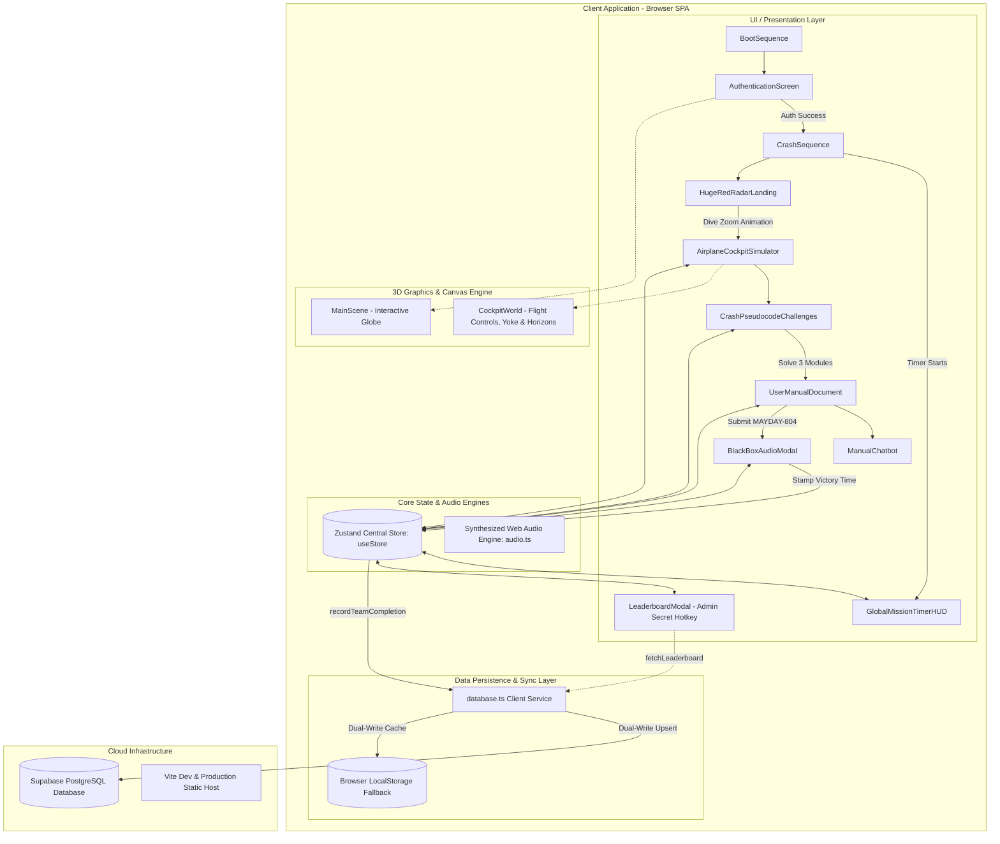
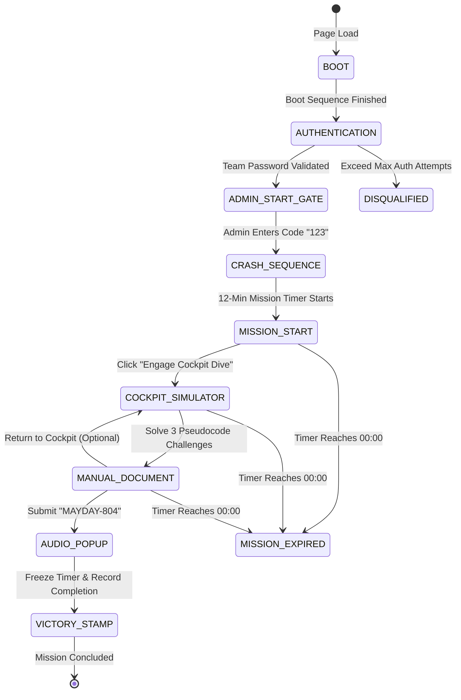
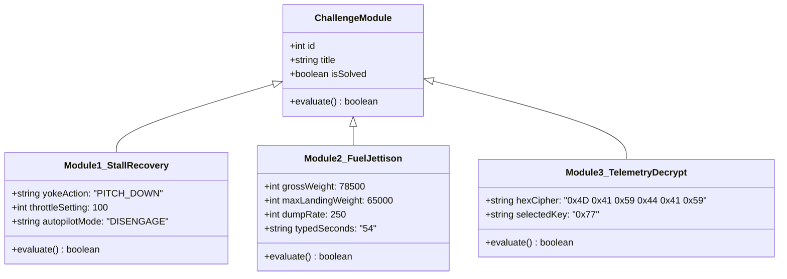

# Mission AI: Impossible — System Architecture Document

```
Document Version: 1.0.0
Author: DeepMind Antigravity Engineering
Project: Mission AI: Impossible (Aviation Cyber-Physical Challenge)
Target Platform: Web (Vite + React 19 + TypeScript + Three.js + Supabase)
```

---

## 1. Executive Summary

**Mission AI: Impossible** is an immersive, high-stakes gamified cyber-physical challenge platform designed for timed team competitions. The scenario immerses participants as cyber-incident responders investigating the crisis of **Flight AI-804**.

The application coordinates:
1. An authentic retro terminal authentication boot sequence.
2. A unified 12-minute ($720\,\text{s}$) mission countdown clock persistently visible across all screens.
3. A tactile landing radar with zoom-in dive kinematics.
4. A 3D interactive cockpit simulator coupled with tough aerospace pseudocode puzzles.
5. A declassified aircraft operational manual with an integrated AI Copilot chatbot.
6. A CVR (Cockpit Voice Recorder) black box emergency audio pop-up triggered by master code authorization (`MAYDAY-804`).
7. Automatic microsecond-accurate time-stamping with fault-tolerant dual persistence (Supabase PostgreSQL + client-side localStorage fallback) and privacy-restricted admin leaderboard viewing.

---

## 2. High-Level System Architecture



---

## 3. Technology Stack

| Layer | Technology | Version | Purpose |
| :--- | :--- | :--- | :--- |
| **Runtime / UI Framework** | React | `^19.2.8` | Declarative UI rendering, component lifecycle |
| **Type System** | TypeScript | `~6.0.2` | Compile-time safety, strict typing (`verbatimModuleSyntax`) |
| **Build Tool & Bundler** | Vite | `^8.3.0` | Ultra-fast HMR, ES module bundling, tree-shaking |
| **State Management** | Zustand | `^5.0.15` | Centralized reactive store for state, timer, and challenge flags |
| **3D Rendering** | Three.js / React Three Fiber / Drei | `^0.186.1` / `^9.8.1` | WebGL canvas, 3D Cockpit world, dynamic aircraft yaw/pitch yoke |
| **Animation Engine** | Framer Motion & GSAP | `^14.0.0` / `^3.15.0` | Tactical radar dive zoom, HUD alerts, UI transitions |
| **Styling** | Tailwind CSS / PostCSS | `^3.4.19` | High-contrast neon radar HUD aesthetics, responsive layouts |
| **Iconography** | Lucide React | `^1.52.0` | Tactical aerospace icons, telemetry symbols |
| **Audio Synthesis** | Web Audio API (Native) | Native | Custom algorithmic oscillators for radio static, Morse, alarms, pilot voice |
| **Cloud Database** | Supabase (PostgreSQL) | `^2.117.3` | Event ranking, team completions, row-level security |

---

## 4. Finite State Machine (Game Lifecycle)

The entire flow is modeled as a deterministic Finite State Machine (FSM) coordinated through Zustand in [`src/store/useStore.ts`](file:///Users/jiyu/Desktop/mission_ai_impossible/src/store/useStore.ts):



### State Breakdown

1. **`BOOT`** (`BootSequence.tsx`):
   - Terminal initialization, kernel self-tests, audio context handshake.
2. **`AUTHENTICATION`** (`AuthenticationScreen.tsx`):
   - Interactive 3D globe background. Validates `team_code` and team password (`DEFAULT_TEAMS`). Retains 2 attempts maximum before triggering `DISQUALIFIED`.
3. **`ADMIN_START_GATE`** (`AdminStartGate.tsx`):
   - Operational security checkpoint shown right after team login. The mission timer remains paused until the event admin inputs authorization code `"123"`.
4. **`CRASH_SEQUENCE`** (`CrashSequence.tsx`):
   - Dramatic telemetry failure alerts. Triggers `useStore.isTimerRunning = true` (starts the 12-minute mission clock upon admin authorization).
4. **`MISSION_START`** (`HugeRedRadarLanding.tsx`):
   - Huge red spinning tactical sweep arm, live magnetic heading readouts, and 1X/2X scan velocity toggle. Click button executes zoom-in camera dive into the 3D cockpit.
5. **`COCKPIT_SIMULATOR`** (`AirplaneCockpitSimulator.tsx` + `CrashPseudocodeChallenges.tsx`):
   - 3D interactive cockpit cabin with yoke tilt, artificial horizon, overhead panel, and high-contrast, center-placed pseudocode terminal.
6. **`MANUAL_DOCUMENT`** (`UserManualDocument.tsx` + `ManualChatbot.tsx`):
   - Unlocked operational manual detailing aerodynamics, fuel formulas, and black box decrypt keys.
   - Interactive AI Copilot chatbot answering questions and disclosing the master key.
7. **`AUDIO_POPUP & VICTORY_STAMP`** (`BlackBoxAudioModal.tsx`):
   - Final code validation triggers CVR black box audio player with live equalizer and pilot broadcast.
   - Timer freezes immediately, and the completion timestamp is dual-written to Supabase and localStorage.

---

## 5. Architectural Components & Directory Structure

```
mission_ai_impossible/
├── src/
│   ├── components/
│   │   ├── 3d/
│   │   │   ├── CockpitWorld.tsx          # 3D WebGL Cockpit with yoke, horizon & instrument panels
│   │   │   ├── GlobeScene.tsx            # 3D Interactive flight route globe
│   │   │   └── MainScene.tsx             # Canvas wrapper for globe
│   │   ├── AirplaneCockpitSimulator.tsx  # Cockpit layout, instruments, caution alerts
│   │   ├── AuthenticationScreen.tsx      # Protected login screen (100% untouched)
│   │   ├── BlackBoxAudioModal.tsx        # CVR Audio transmission modal & final victory stamp
│   │   ├── BootSequence.tsx              # Retro BIOS boot terminal sequence
│   │   ├── CrashPseudocodeChallenges.tsx # Multi-step crash recovery pseudocode puzzles
│   │   ├── CrashSequence.tsx             # Distress alert & timer kickoff trigger
│   │   ├── CustomCursor.tsx              # Tactical crosshair cursor
│   │   ├── GlobalEffects.tsx             # CRT scanlines & vignette
│   │   ├── GlobalMissionTimerHUD.tsx     # Persistent top mission countdown timer & team badge
│   │   ├── HugeRedRadarLanding.tsx       # Centerpiece spinning tactical radar with dive zoom
│   │   ├── LeaderboardModal.tsx          # Admin secret ranking modal (Alt+L)
│   │   ├── ManualChatbot.tsx             # AI Copilot interactive chatbot
│   │   └── UserManualDocument.tsx        # Declassified manual & final code submission prompt
│   ├── lib/
│   │   ├── audio.ts                      # Web Audio API algorithmic sound engine
│   │   └── database.ts                   # Supabase client + local storage fallback sync
│   ├── store/
│   │   └── useStore.ts                   # Zustand centralized store & timer state
│   ├── App.tsx                           # Master view router, global HUD & admin shortcut
│   └── main.tsx                          # Vite React root
├── supabase/
│   └── schema.sql                        # PostgreSQL schema, RLS policies & initial teams
├── .env.example                          # Supabase configuration template
├── package.json                          # Dependencies & build scripts
└── tsconfig.app.json                     # Strict TypeScript compiler options
```

---

## 6. Challenge Engine & Pseudocode Logic

The challenges simulate real-world aircraft systems recovery:



### Module 1: Aerodynamic Stall & Compressor Surge Recovery
- **Condition**: $\text{AoA} = 22.4^\circ > 18.0^\circ$, Airspeed $145\,\text{KIAS} < 160\,\text{KIAS}$.
- **Resolution**:
  - `Yoke Action`: `PITCH_DOWN` (reduces angle of attack below critical threshold).
  - `Throttle`: `MAX_POWER` (100% thrust to recover airspeed).
  - `Autopilot`: `DISENGAGE` (manual override required).

### Module 2: Center-of-Gravity Fuel Jettison Formula
- **Condition**: Gross Weight $= 78,500\,\text{kg}$, MLW (Maximum Landing Weight) $= 65,000\,\text{kg}$.
- **Formula**:
  $$\Delta W = 78,500 - 65,000 = 13,500\,\text{kg}$$
  $$T_{\text{dump}} = \frac{\Delta W}{\text{Dump Rate}} = \frac{13,500\,\text{kg}}{250\,\text{kg/s}} = 54\,\text{seconds}$$
- **Resolution**: Participant types `54` into the console. Triggers real-time gauge animation down to $65,000\,\text{kg}$.

### Module 3: FDR Black Box Telemetry Decryption
- **Condition**: Telemetry stream masked by bitwise XOR noise.
- **Resolution**: Participant selects correct hex XOR mask key `0x77` to decrypt `MAYDAY-804-BEACON-LOCKED`.

---

## 7. Data Layer & Deployment Architecture

```mermaid
sequenceDiagram
    autonumber
    actor Participant as Team Participant
    participant UI as UserManualDocument
    participant Store as useStore (Zustand)
    participant DB as database.ts
    participant Local as localStorage
    participant Cloud as Supabase PostgreSQL
    actor Admin as Event Organizer

    Participant->>UI: Enters authorization code "MAYDAY-804"
    UI->>Store: stampFinalVictory()
    Note over Store: Freezes 12-min timer<br/>Calculates elapsed time (sec)
    Store->>DB: recordTeamCompletion("TEAM-001", elapsedSeconds, 3)
    
    par Dual Persistence
        DB->>Local: saveLocalLeaderboard(updatedEntries)
        DB->>Cloud: upsert into mission_leaderboard
    end

    Store-->>UI: isAudioPopupOpen = true
    UI-->>Participant: CVR Black Box Audio Pops Up (Game Over)

    opt Admin View (Alt + L)
        Admin->>UI: Press Alt + L (Secret Key)
        UI->>DB: fetchLeaderboard()
        DB->>Cloud: SELECT * ORDER BY time_taken_seconds ASC
        Cloud-->>DB: Return ranked teams
        DB-->>Admin: Displays Live Leaderboard Modal
    end
```

### PostgreSQL Schema (`supabase/schema.sql`)

```sql
CREATE TABLE IF NOT EXISTS public.mission_leaderboard (
  id UUID PRIMARY KEY DEFAULT gen_random_uuid(),
  team_code TEXT UNIQUE NOT NULL REFERENCES public.teams(team_code),
  team_name TEXT NOT NULL,
  time_taken_seconds INT NOT NULL,
  formatted_time TEXT NOT NULL,
  challenges_completed INT DEFAULT 3,
  status TEXT DEFAULT 'COMPLETED',
  completed_at TIMESTAMPTZ DEFAULT NOW()
);
```

### Winner Determination Query
Winners are ranked in ascending order of completion time (fastest time = Rank 1 🏆):
```sql
SELECT 
  team_code, 
  team_name, 
  formatted_time, 
  time_taken_seconds, 
  completed_at 
FROM public.mission_leaderboard 
WHERE status = 'COMPLETED' 
ORDER BY time_taken_seconds ASC;
```

---

## 8. Reliability, Security & Event Integrity

1. **Strict Participant Privacy**:
   - All public leaderboard buttons are hidden from the participant view during the live competition.
   - Organizer access is restricted to the secret hotkey **`Alt + L`** or directly via the cloud database console.
2. **Offline-First Resilience**:
   - The dual-write mechanism writes to `localStorage` first and asynchronously upserts to Supabase in a `try/catch` block. If the competition venue suffers Wi-Fi dropouts, zero game crashes occur and all stamped records are preserved.
3. **Audio Autoplay Defense**:
   - Audio contexts are initialized only upon intentional user interaction (`soundFx.init()`), eliminating browser `NotAllowedError` policy exceptions.
4. **Timer Integrity**:
   - The mission timer is globally scoped in Zustand, preventing drift or duplicate intervals during screen transitions.
